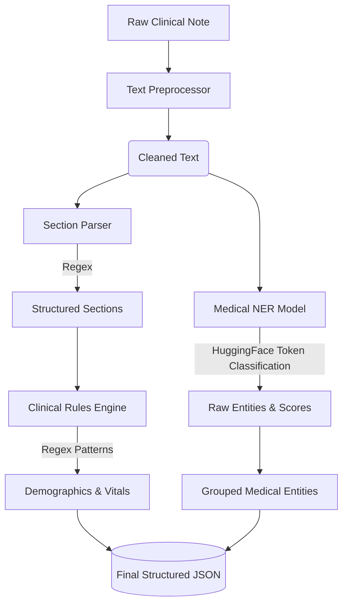

# StegIT NLP Pipeline & Techniques

This document outlines the Natural Language Processing (NLP) techniques and the data extraction pipeline implemented in the StegIT codebase. The system employs a hybrid approach, combining traditional rule-based methods with advanced deep learning transformer models to process clinical text.

## Pipeline Architecture

The primary text processing pipeline (driven by `main.py` and the `src/` module) flows through four main stages:

1. **Text Preprocessing:** Cleaning and normalizing raw clinical notes.
2. **Section Parsing:** Structuring the unstructured text into clinical headings.
3. **Rule-Based Extraction:** Pulling structured demographics and vitals using deterministic rules.
4. **Medical Named Entity Recognition (NER):** Using deep learning to identify and classify complex medical concepts.

---

## Core NLP Techniques Used

### 1. Rule-Based NLP & Regular Expressions (Regex)
**Used in:** `src/section_parser.py` and `src/clinical_rules.py`

Before applying heavy machine learning models, the pipeline uses deterministic rules to structure the document and extract highly formatted data.

* **Section Parsing:** The `SectionParser` uses regex to locate standard clinical headers (e.g., `SUBJECTIVE:`, `OBJECTIVE:`, `ASSESSMENT:`). It slices the continuous text into a dictionary of sections, allowing downstream tasks to focus only on relevant parts of the note.
* **Clinical Rules Extraction:** The `ClinicalRules` class uses pattern matching to find specific data points:
  * **Demographics:** Age (e.g., `\d+-year-old`), Gender, Race.
  * **Vitals:** Blood Pressure (`\d+/\d+`), Heart Rate, SpO2, Weight.
* **Why this technique?** Regex is extremely fast, highly accurate, and computationally cheap for data that follows predictable formats (like a blood pressure reading).

### 2. Transformer-Based Deep Learning (Medical NER)
**Used in:** `src/ner.py` and `config.py`

For unstructured, variable clinical narratives where rules fail, the pipeline utilizes state-of-the-art Transformer models via the Hugging Face `pipeline`.

* **The Model:** The project configuration (`config.py`) defines `Clinical-AI-Apollo/Medical-NER` as the primary token-classification model. The configuration also references `emilyalsentzer/Bio_ClinicalBERT` (ClinicalBERT), a foundational language model pre-trained specifically on MIMIC III clinical notes, indicating the architectural backbone suited for clinical embeddings.
* **How it works:** 
  * The `MedicalNER` class initializes a `token-classification` pipeline.
  * Text is tokenized and passed through the model layers (often BERT-based).
  * The model predicts an `entity_group` (label) and a confidence `score` for each token.
  * Entities are grouped, deduplicated, and categorized (e.g., Medications, Diseases, Procedures).

### 3. ConText Algorithm & Dependency Parsing (PDF Pipeline)
**Used in:** `clinical_pipeline.py`

For extracting data from PDF reports, a secondary pipeline uses `medspacy`.

* **Context Flagger:** It isn't enough to just extract a medical entity using NER; the system needs to know the *context*. MedSpacy implements the **ConText algorithm**, which looks at the linguistic modifiers surrounding an entity.
* **Technique:** It determines if a condition is:
  * **Negated** ("Patient *denies* chest pain")
  * **Historical** ("*History of* hypertension")
  * **Hypothetical** ("*Monitor for* infection")

---

## Summary of the Flow (`main.py`)

